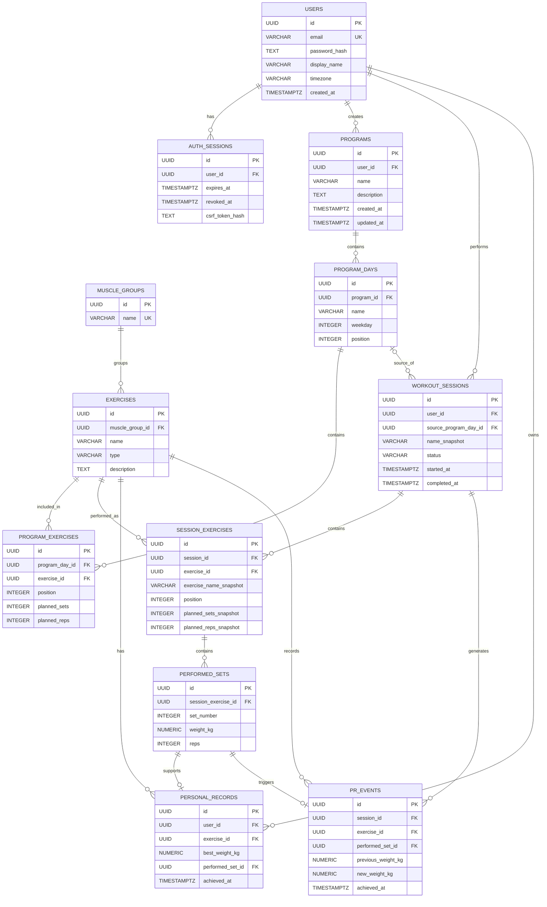

# Model preliminar de date și API

Modelul este o propunere pentru PostgreSQL. ID-urile sunt UUID, momentele sunt `timestamptz` în UTC, iar greutățile sunt `numeric(8,2)` în kg. Câmpurile sunt obligatorii dacă nu sunt marcate opționale.

## Diagrama ERD

## Entități și relații

| Entitate | Câmpuri principale | Relații și constrângeri |
| --- | --- | --- |
| `users` | `id`, `email`, `password_hash`, `display_name`, `timezone`, `created_at` | Email normalizat și unic; un utilizator are mai multe programe, sesiuni și PR-uri. |
| `auth_sessions` | `id`, `user_id`, `expires_at`, `revoked_at` opțional, `csrf_token_hash` | Mai multe sesiuni de autentificare pentru un utilizator; fără stocarea JWT-ului brut. |
| `muscle_groups` | `id`, `name` | Nume unic; o grupă are mai multe exerciții. |
| `exercises` | `id`, `muscle_group_id`, `name`, `type`, `description` opțional | Fiecare exercițiu are o grupă principală în MVP; catalog standard comun. |
| `programs` | `id`, `user_id`, `name`, `description` opțional, `created_at`, `updated_at` | Un utilizator are mai multe programe; fiecare program are zile ordonate. |
| `program_days` | `id`, `program_id`, `name`, `weekday` opțional, `position` | Ziua săptămânii este 1–7; poziție unică în program. |
| `program_exercises` | `id`, `program_day_id`, `exercise_id`, `position`, `planned_sets`, `planned_reps` | Leagă ziua de exercițiu; seriile și repetările sunt întregi pozitivi; poziție unică în zi. |
| `workout_sessions` | `id`, `user_id`, `source_program_day_id` opțional, `name_snapshot`, `status`, `started_at`, `completed_at` opțional | O zi poate genera mai multe sesiuni; starea finalizată cere `completed_at`. |
| `session_exercises` | `id`, `session_id`, `exercise_id`, `exercise_name_snapshot`, `position`, `planned_sets_snapshot`, `planned_reps_snapshot` | Copie a planificării la pornire; leagă sesiunea de exercițiul folosit la agregări. |
| `performed_sets` | `id`, `session_exercise_id`, `set_number`, `weight_kg`, `reps` | Număr unic în cadrul exercițiului sesiunii; `weight_kg >= 0`, `reps > 0`. |
| `personal_records` | `id`, `user_id`, `exercise_id`, `best_weight_kg`, `performed_set_id`, `achieved_at` | Perechea utilizator–exercițiu este unică; referința indică seria care susține recordul curent. |
| `pr_events` | `id`, `session_id`, `exercise_id`, `performed_set_id`, `previous_weight_kg` opțional, `new_weight_kg`, `achieved_at` | Un eveniment per exercițiu și sesiune; păstrează recordul obținut atunci, chiar dacă PR-ul curent este depășit ulterior. |

`session_exercises` și `program_exercises` rezolvă relațiile multiple cu exercițiile și păstrează ordinea. Același exercițiu poate apărea de mai multe ori într-o zi, în poziții distincte. Pentru PR se consideră toate seriile lui din sesiune.

## Constrângeri de unicitate (UNIQUE)

Pe lângă cheile primare și străine prezentate în diagramă, baza de date utilizează următoarele constrângeri de unicitate:

- `USERS.email` – fiecare utilizator trebuie să aibă o adresă de e-mail unică.
- `MUSCLE_GROUPS.name` – fiecare grupă musculară are un nume unic.
- `PERSONAL_RECORDS(user_id, exercise_id)` – un utilizator poate avea un singur record personal curent pentru fiecare exercițiu.
- `PERSONAL_RECORDS.performed_set_id` – o serie poate fi asociată unui singur record personal curent.
- `PR_EVENTS(session_id, exercise_id)` – un exercițiu poate genera cel mult un eveniment PR într-o sesiune.
- `PR_EVENTS.performed_set_id` – o serie poate genera cel mult un eveniment PR.

## Integritate și păstrarea istoricului

- Cheile externe protejează referințele. Exercițiile standard deja folosite nu se șterg fizic; modificările de nume nu afectează copiile istorice.
- La pornire, configurația zilei este copiată într-o tranzacție; sesiunile nu citesc ulterior țintele din programul modificabil.
- La actualizarea structurii unui program se păstrează ID-urile zilelor existente când este posibil. Eliminarea unei zile setează sursa sesiunilor la NULL; copiile istorice rămân intacte.
- Un program se salvează atomic cu toate zilele și exercițiile sale. O configurație invalidă nu produce salvare parțială.
- Backend-ul verifică faptul că ziua sursă aparține utilizatorului și că orice serie referită de un PR/eveniment aparține aceluiași utilizator și exercițiu. Aceste verificări sunt acoperite de teste de integrare.
- Pentru maxim egal în aceeași sesiune, se păstrează seria cu momentul logic cel mai timpuriu, determinat prin ordinea exercițiului și numărul seriei. Egalitatea cu recordul anterior nu generează eveniment.
- Indexuri propuse: `workout_sessions(user_id, completed_at)`, `programs(user_id)`, `session_exercises(exercise_id, session_id)` și indexuri pe cheile externe; unicitatea PR este susținută de indexul perechii sale.

Șabloanele, exercițiile personalizate și realizările nu sunt modelate în MVP. Extensiile vor avea migrații separate după stabilizarea funcțiilor obligatorii.

## Convenții API

Prefix: `/api/v1`. Cereri și răspunsuri JSON; autentificarea folosește cookie-ul de sesiune descris în [arhitectură](architecture.md). Toate rutele, exceptând înregistrarea și login-ul, necesită autentificare. Scrierile autentificate cer și token CSRF. Datele private sunt filtrate după utilizatorul autentificat, fără `user_id` ales de client.

Listele paginate folosesc `page` (implicit 1) și `pageSize` (implicit 20, maximum 100), cu răspuns `{ items, page, pageSize, total }`. Datele temporale sunt ISO 8601. Greutățile și volumele zecimale se transmit ca șiruri exacte, de exemplu `"65.00"`, iar frontend-ul le convertește pentru afișare/grafice.

| Metodă și rută | Date principale / scop | Rezultat |
| --- | --- | --- |
| `POST /auth/register` | `email`, `password`, `displayName`; fus orar implicit UTC | 201, profil public al contului nou; nu autentifică automat. |
| `POST /auth/login` | `email`, `password` | 200, profil și token CSRF; setează cookie-ul JWT. |
| `POST /auth/logout` | Revocarea sesiunii curente | 204 și eliminarea cookie-ului. |
| `GET /auth/csrf` | Recuperarea tokenului CSRF după reîncărcarea paginii | 200, token asociat sesiunii active, cu răspuns necacheabil. |
| `GET /me` | Citirea profilului | 200, `id`, `email`, `displayName`, `timezone`. |
| `PATCH /me` | `displayName`, `timezone` | 200, profil actualizat. |
| `GET /muscle-groups` | Grupele disponibile | 200, listă. |
| `GET /exercises` | Filtre `muscleGroupId`, `type`, `search`; paginare | 200, exerciții standard. |
| `GET /programs` | Lista programelor personale, paginată | 200, listă. |
| `POST /programs` | `name`, `description?`, `days[]`, cu `exercises[]` și ținte | 201, program complet. |
| `GET /programs/:id` | Program cu zile și exerciții ordonate | 200, detaliu. |
| `PUT /programs/:id` | Configurația completă validată; ID-uri pentru zilele/exercițiile existente | 200, program actualizat atomic. |
| `POST /sessions` | `programDayId` | 201, sesiune în curs cu copia zilei. |
| `GET /sessions` | `status`, `from`, `to`, paginare | 200, sesiuni personale; `completed` pentru istoric, `in_progress` pentru reluare. |
| `GET /sessions/:id` | Exerciții, ținte și serii efective | 200, detaliu și eventuale evenimente PR. |
| `PUT /sessions/:id/exercises/:sessionExerciseId/sets/:setNumber` | `weightKg`, `reps`; număr pozitiv al seriei | 201 la creare / 200 la înlocuire; upsert idempotent într-o sesiune în curs. |
| `DELETE /sessions/:id/exercises/:sessionExerciseId/sets/:setNumber` | Eliminarea unei serii salvate din sesiunea în curs | 204. |
| `POST /sessions/:id/complete` | Finalizare fără payload suplimentar | 200, rezumat și `newRecords`; repetarea întoarce rezultatul existent. |
| `GET /records` | `exerciseId` opțional | 200, PR-urile curente, independente de intervalul dashboard-ului. |
| `GET /stats/progress` | `exerciseId` obligatoriu, `from`, `to`, `timezone` | 200, maxime și volum pe zi, frecvență săptămânală și totaluri. |
| `GET /stats/summary` | `from`, `to`, `timezone` | 200, număr de sesiuni și volum pentru toate exercițiile; folosit în dashboard. |

`from` și `to` sunt momente cu offset convertite în UTC, cu sfârșit exclusiv. `timezone` stabilește gruparea calendaristică; săptămâna începe luni. Parametrii se validează; începutul nu poate fi după sau egal cu sfârșitul. Pentru progres, sesiunile sunt selectate după `completed_at` și numai dacă au starea `completed`.

## Erori

Forma propusă este `{ error: { code, message, fields? }, requestId }`. Coduri: 400 pentru JSON/parametri malformați, 401 pentru autentificare absentă sau expirată, 403 pentru CSRF invalid, 404 pentru resursă absentă ori neaparținând utilizatorului, 409 pentru email duplicat sau modificarea unei sesiuni finalizate, 422 pentru valori de domeniu invalide/finalizare fără serii și 429 pentru prea multe încercări. Erorile interne returnează 500 cu mesaj generic și ID de cerere.
