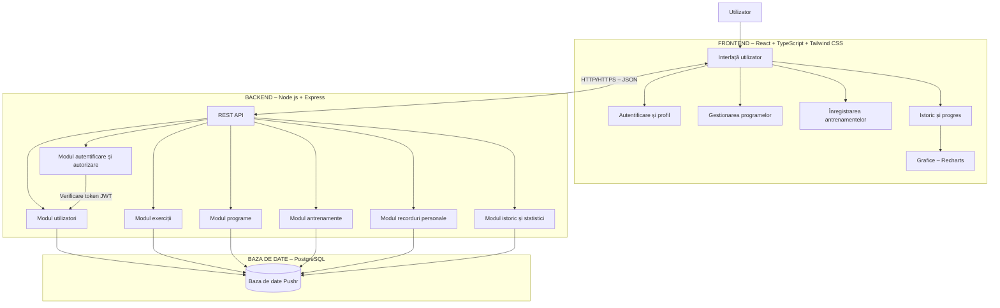

# Diagrama arhitecturii – Pushr

## Descriere

Aplicația Pushr utilizează o arhitectură de tip monolit modular, organizată în trei componente principale: frontend, backend și baza de date.

Frontend-ul este dezvoltat folosind React și TypeScript, backend-ul utilizează Node.js și Express, iar datele sunt stocate într-o bază de date PostgreSQL.

Componentele comunică prin intermediul API-urilor REST, utilizând protocolul HTTP/HTTPS și formatul JSON pentru schimbul de date.

## Diagrama arhitecturii

## Comunicarea dintre componente

1. Utilizatorul interacționează cu interfața aplicației prin intermediul browserului.
2. Frontend-ul React trimite cereri HTTP către REST API-ul din backend.
3. Backend-ul Express primește cererile și le direcționează către modulul corespunzător.
4. Modulul de autentificare verifică identitatea utilizatorului folosind JWT.
5. Modulele backend accesează baza de date PostgreSQL pentru citirea și salvarea informațiilor.
6. Backend-ul transmite răspunsurile către frontend în format JSON.
7. Frontend-ul actualizează interfața și afișează datele utilizatorului, inclusiv graficele de progres.
