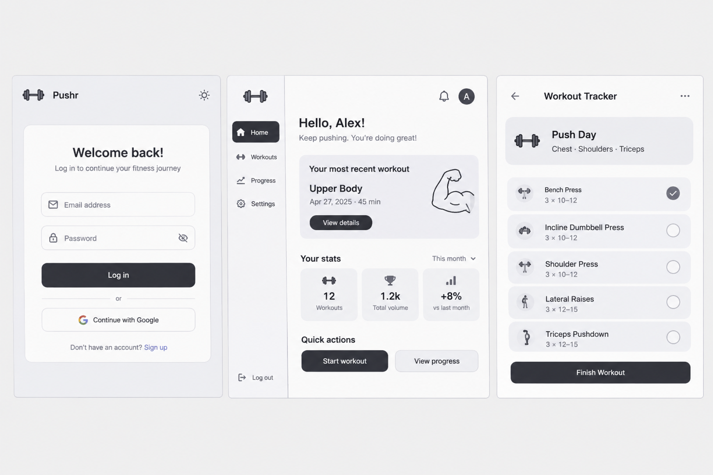
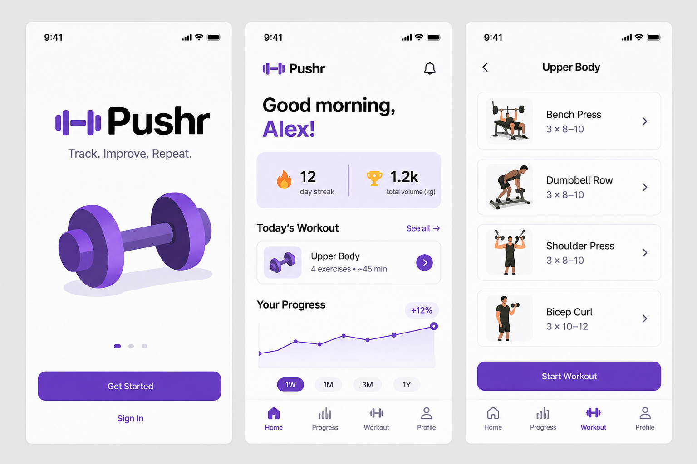
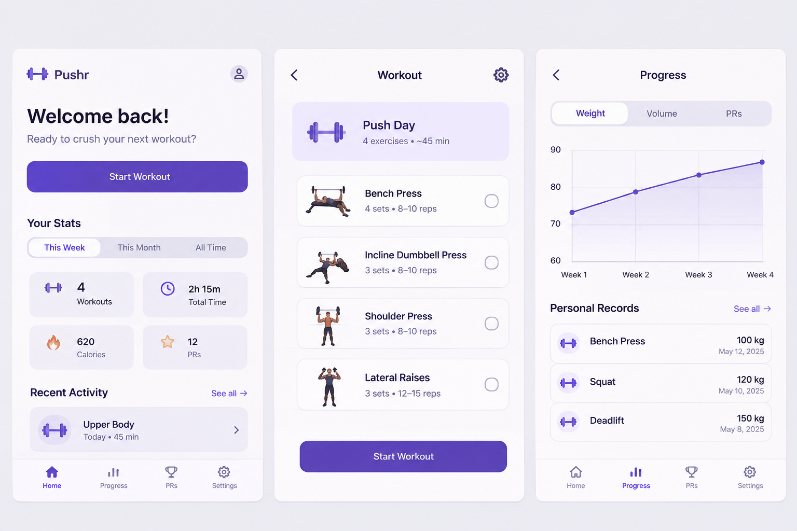

# Ecrane principale și navigare

Acest director reunește wireframe-urile și mockup-urile ecranelor principale, fluxurile de navigare și specificațiile detaliate ale interfeței. Imaginile sunt propuneri vizuale preliminare; descrierile de mai jos și [cerințele proiectului](../requirements.md) definesc comportamentul planificat.

## Wireframe desktop — autentificare, dashboard și antrenament

Cele trei panouri ilustrează autentificarea (E-01), dashboard-ul (E-09) și sesiunea de antrenament (E-08). Navigarea laterală oferă acces la antrenamente, progres și setări; acțiunile principale permit pornirea și finalizarea unei sesiuni.

## Mockup mobil — introducere, dashboard și zi de antrenament

Panourile prezintă o introducere vizuală, dashboard-ul (E-09) și ziua de antrenament dintr-un program (E-07). „Sign In” conduce la autentificare, iar „Start Workout” deschide sesiunea activă (E-08). Bara inferioară ilustrează accesul rapid la dashboard, progres, antrenamente și profil. Ecranul introductiv este o propunere vizuală, fără cerință funcțională separată în MVP.

## Mockup mobil — dashboard, antrenament și progres

Panourile ilustrează dashboard-ul (E-09), ziua de antrenament (E-07) și progresul cu recorduri personale (E-12). Lista activităților recente deschide detaliul unei sesiuni (E-11), iar selectarea unui exercițiu în progres permite consultarea performanțelor sale.

## Interpretarea propunerilor vizuale

- Valorile, datele, numele și graficele din imagini sunt exemple de prezentare, nu date reale sau rezultate validate.
- Autentificarea Google, notificările, caloriile și alegerea temei sunt idei vizuale care nu sunt incluse în cerințele MVP. Realizările de consecvență și compararea perioadelor rămân opționale.
- Intervalele de repetări din imagini sunt orientative; MVP folosește un număr întreg de repetări planificate, conform modelului de date.
- Volumul se exprimă în kg·repetări, conform regulii RB-04; indicatorii de timp din imagini nu înlocuiesc indicatorii obligatorii de volum, frecvență și greutate maximă.
- Variantele de meniu reprezintă alternative de prezentare. Destinațiile necesare sunt definite în fluxurile și specificațiile de mai jos. Ecranele fără imagine dedicată sunt descrise textual.

## Fluxuri de navigare

1. Vizitatorul intră în autentificare, poate trece la înregistrare, apoi revine la autentificare; după login ajunge la dashboard.
2. Din dashboard deschide „Programe”, alege „Program nou”, configurează zilele și deschide selectorul bibliotecii. Confirmarea selecției îl întoarce în editor; salvarea deschide detaliul programului.
3. Din detaliul programului alege o zi și „Începe antrenamentul”. Salvează seriile în ecranul sesiunii, apoi finalizează și ajunge la rezumatul din istoric.
4. Din „Istoric” deschide o sesiune; din detaliu poate deschide „Progres” pentru un exercițiu. Revenirea la istoric păstrează perioada și pagina selectate.
5. Din navigarea principală deschide „Profil”, salvează modificările și revine la pagina anterioară. „Deconectare” închide sesiunea și deschide autentificarea.

Accesarea directă a unei pagini private fără autentificare deschide login-ul. După autentificare se poate reveni la destinația internă cerută, dacă utilizatorul are acces. Un ID inexistent sau inaccesibil afișează „Resursa nu a fost găsită”.

## Comportament comun

- Desktop: antet cu numele Pushr și contul; navigare laterală; titlu și acțiunea principală în partea de sus a conținutului.
- Mobil: antet compact și meniu accesibil pentru Dashboard, Programe, Exerciții, Istoric, Progres și Profil; conținut pe o coloană.
- Formularele au etichete persistente, erori lângă câmp și o confirmare după salvare. Stările de încărcare și eroare sunt distincte de listele goale.
- Butoanele de trimitere sunt dezactivate cât timp cererea este în curs. Datele introduse nu sunt șterse la eroare.
- Părăsirea unui formular cu modificări nesalvate solicită confirmare. Seriile deja confirmate ca salvate rămân pe server.
- Graficele aplicației vor avea și un rezumat numeric/tabel accesibil.

## Cont și structură comună

### E-01 — Autentificare (`/login`)

În centrul paginii apare un formular compact. De sus în jos: numele Pushr, titlul „Autentificare”, câmpul Email, câmpul Parolă cu control de afișare, butonul „Intră în cont” și legătura „Nu ai cont? Creează cont”. Pe mobil formularul folosește lățimea disponibilă cu margini laterale.

Login-ul reușit deschide `/dashboard`. Datele greșite afișează un mesaj generic deasupra butonului. Câmpurile obligatorii au erori individuale; emailul se păstrează după o eroare. Parola nu se include în URL sau mesaje.

### E-02 — Înregistrare (`/register`)

Aceeași structură ca E-01. Conținutul este: „Creează cont”, Nume afișat, Email, Parolă, Confirmă parola, indicația privind minimum 12 caractere, butonul „Creează cont” și legătura „Ai deja cont? Autentificare”. Confirmarea parolei este validată în interfață; API-ul primește o singură parolă.

După succes, utilizatorul vede confirmarea și revine la autentificare cu emailul precompletat. Emailul duplicat și parola neconformă au mesaje explicite. Înregistrarea nu afișează dashboard-ul înainte de autentificare.

### E-03 — Profil (`/profile`)

Sub navigarea comună apar titlul „Profilul meu”, Email (doar citire în MVP), Nume afișat, selector Fus orar și unitatea „kg” (fixă în MVP). La final: „Salvează modificările” și „Deconectare”. Salvarea păstrează pagina și afișează confirmarea; deconectarea revocă sesiunea și deschide `/login`.

### Verificare vizuală propusă

La 360 px câmpurile și butoanele rămân vizibile fără scroll orizontal. Ordinea de tabulare urmează ordinea vizuală; fiecare câmp are etichetă, iar erorile pot fi identificate fără a depinde doar de culoare.

## Planificare și antrenament

### E-04 — Biblioteca (`/exercises`)

Sub titlul „Exerciții” apar căutarea după nume și selectoarele Grupă musculară și Tip. Urmează lista cu numele, grupa principală și tipul fiecărui exercițiu. Pe desktop filtrele sunt pe același rând; pe mobil se așază vertical. Lista include paginare și stări pentru încărcare, eroare și lipsa rezultatelor.

Deschiderea din editor folosește un selector cu aceleași filtre și butoanele „Adaugă selecția” și „Anulează”. Confirmarea păstrează ziua în curs de editare. Biblioteca accesată din meniul principal este doar pentru consultare.

### E-05 — Programe (`/programs`)

Titlul și „Program nou” sunt în partea de sus. Urmează carduri cu numele programului, zilele configurate și „Deschide”. Starea goală explică faptul că primul program trebuie creat și oferă aceeași acțiune principală.

### E-06 — Editor program (`/programs/new`, `/programs/:id/edit`)

De sus în jos: legătura „Înapoi la programe”, titlul, Nume program și Descriere opțională. Urmează lista zilelor, fiecare cu nume, ziua săptămânii opțională, ordinea și acțiunea „Adaugă exerciții”. În fiecare zi, exercițiile au nume, Serii, Repetări, „Mută mai sus”, „Mută mai jos” și „Elimină”. Zilele se adaugă cu „Adaugă zi”.

La final apar „Salvează programul” și „Anulează”. Pe mobil câmpurile unui exercițiu se grupează vertical. Salvarea deschide detaliul; anularea revine la listă, cu confirmare dacă există modificări. Programul nu poate fi salvat fără nume, fără zile sau cu o zi fără exerciții.

### E-07 — Detaliu program (`/programs/:id`)

Antetul conține numele și „Editează”. Fiecare zi afișează exercițiile ordonate și țintele, de exemplu „Bench Press — 3 × 8”. Acțiunea „Începe antrenamentul” aparține unei zile, astfel încât sursa sesiunii să fie explicită. Dacă există deja o sesiune în curs pentru ziua respectivă, interfața oferă „Continuă sesiunea” și evită pornirea accidentală a alteia.

### E-08 — Sesiune activă (`/sessions/:id`)

Sus apar numele zilei, ora începerii și eticheta „În curs”. Fiecare exercițiu are ținta planificată și o listă de serii: număr, câmp Greutate (kg), câmp Repetări, „Salvează seria”, „Șterge” și starea „Salvat”/„Nesalvat”. „Adaugă serie” permite depășirea numărului planificat. Seriile planificate fără valori sunt doar câmpuri de introducere și nu sunt rezultate efectuate.

Acțiunea finală este „Finalizează antrenamentul”. Ea salvează mai întâi modificările valide și apoi cere finalizarea. Dacă o salvare eșuează, finalizarea nu continuă. Succesul deschide detaliul sesiunii cu rezumat și PR-uri noi. Părăsirea paginii nu finalizează sesiunea; utilizatorul o poate relua din dashboard.

## Dashboard, istoric și progres

### E-09 — Dashboard (`/dashboard`)

Sub salut și titlu apar, în ordine: sesiuni în curs cu „Continuă”, accesul „Vezi programele”, indicatorii pentru ultimele 30 de zile calendaristice (azi și precedentele 29 de zile), lista ultimelor sesiuni finalizate și recordurile curente. Indicatorii sunt sesiuni finalizate, volum total și greutate maximă pentru exercițiul selectat; fără exercițiu ales, greutatea maximă nu se agregă între exerciții.

Pe desktop indicatorii sunt alăturați; pe mobil sunt verticali. Un cont nou vede „Creează primul program” și explicații scurte, fără performanțe fictive. Selectarea unei sesiuni deschide istoricul detaliat; „Vezi progresul” deschide E-12.

### E-10 — Istoric (`/history`)

Titlul este urmat de filtrele Dată început și Dată sfârșit și butonul „Aplică”. Lista descrescătoare arată data, numele sesiunii, numărul de exerciții și volumul total. Fiecare element are „Vezi detalii”. Paginarea se află sub listă. Pe mobil, rândurile devin carduri cu aceleași informații.

### E-11 — Detaliu sesiune (`/history/:id`)

Sus apar „Înapoi la istoric”, numele, data, ora și starea „Finalizat”. Rezumatul include volumul și PR-urile obținute la finalizare. Fiecare exercițiu afișează seriile cu greutatea și repetările efective și legătura „Vezi progresul acestui exercițiu”. În MVP pagina este doar pentru consultare. După finalizarea din logger, această pagină include mesajul „Antrenament salvat”.

### E-12 — Progres (`/progress`)

Ordinea conținutului este: titlu, selector Exercițiu, Dată început, Dată sfârșit și „Aplică”. Urmează indicatorii Greutate maximă, Volum total și Sesiuni finalizate pentru selecție; apoi zonele de vizualizare a greutății maxime pe zi, volumului pe zi și frecvenței pe săptămână, însoțite de un tabel cu valorile.

PR-ul curent pentru exercițiu are o etichetă distinctă, „Record personal, toate sesiunile”, pentru a nu fi confundat cu maximul perioadei. Intervalul gol afișează explicația și opțiunea de a modifica filtrele. O cerere eșuată afișează eroare și „Reîncearcă”; nu este prezentată drept interval fără date.

### Legătura cu acceptanța

E-09–12 acoperă UC-03 și UC-04. Verificarea folosește valorile numerice din scenarii, atât în indicatori, cât și în tabelul asociat vizualizărilor. Filtrele și indicatorii trebuie să rămână lizibili la 360 px și operabili cu tastatura.
